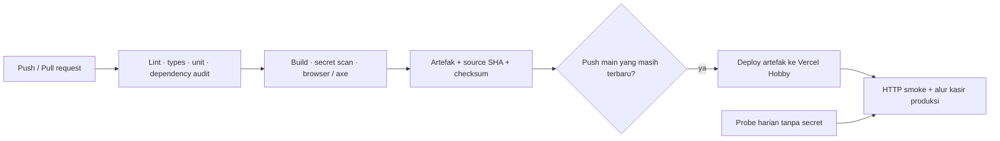

# AUU AHH Cafe — DevOps, DevSecOps & SRE Portfolio

Portofolio sederhana untuk menunjukkan delivery aplikasi dari commit sampai layanan publik: CI/CD GitHub Actions, quality/security gates, integritas artefak, deployment Vercel Hobby, dan pemeriksaan kesehatan layanan. Aplikasi contohnya adalah menu dan ringkasan pesanan kafe, dibuat dengan Next.js 16, React 19, dan TypeScript.

[](https://github.com/Adrian463588/auu-ahh-cafe-menu/actions/workflows/ci.yml)
[](https://github.com/Adrian463588/auu-ahh-cafe-menu/actions/workflows/health.yml)

[Buka website](https://auu-ahh-cafe-menu.vercel.app) · [Repo privat](https://github.com/Adrian463588/auu-ahh-cafe-menu)

Repo saat ini privat; akses source, badge, dan log Actions mengikuti izin GitHub. Hosting hanya memakai berkas statis, tanpa database atau runtime function.

## Yang diperagakan

| Area | Implementasi yang dapat diperiksa |
| --- | --- |
| DevOps | Pull request/push memicu CI; `npm ci` memakai lockfile; build yang telah diuji disimpan sebagai artefak dan dipublikasikan tanpa build ulang |
| DevSecOps | ESLint/Next/TypeScript, Gitleaks history + sumber + export, audit dependency, Actions dengan SHA pinning/read-only token, checksum tool, secret khusus deployment, dan verifikasi hash/commit sebelum publikasi |
| SRE | Smoke sesudah deploy, alur browser produksi, probe HTTP harian, latency sampel, target SLI/SLO awal, dan runbook investigasi/rollback |



PR dan pemicu manual hanya memverifikasi kode. Publikasi otomatis berjalan pada push `main` sesudah seluruh gates lulus. Secret Vercel tersedia hanya pada langkah publikasi; job tersebut tidak menginstal dependency aplikasi dan tidak membuat build baru.

`main` mewajibkan PR dan status **Quality and security gates** yang mutakhir, termasuk untuk admin; force-push dan penghapusan branch diblokir. Proyek memakai satu maintainer, sehingga tidak mengklaim adanya persetujuan reviewer kedua.

## Fitur

- 32 menu dalam 7 kategori dari dokumen asli, beserta harga dan varian Hot/Ice yang tercantum.
- Pencarian, filter kategori, jumlah pesanan, hapus, dan total rupiah.
- Keranjang dan detail pemesan disimpan hanya di perangkat pengunjung.
- Ringkasan untuk ditunjukkan ke kasir, dengan pilihan makan di tempat/bawa pulang, salin, dan cetak/simpan PDF melalui browser.
- Dukungan keyboard, layout ponsel/tablet/desktop, pemulihan error penyimpanan, dan penggunaan halaman yang sudah terbuka saat offline.

Ringkasan **belum dikirim atau dikonfirmasi oleh kafe**. Pembayaran, ketersediaan, serta permintaan khusus dikonfirmasi langsung ke kasir. Tidak ada pengumpulan pesanan di server.

## Menjalankan

Gunakan Node.js 24 dan npm.

```sh
npm ci --ignore-scripts
npm run dev
```

Buka URL lokal yang dicetak Next.js. Untuk build dan preview hasil produksi:

```sh
npm run build
npm run preview
```

Preview statis tersedia di `http://127.0.0.1:4173`.

## Verifikasi

```sh
npm run tools:install
npm run lint
npm run lint:workflows
npm test
npm run typecheck
npm audit --audit-level=low
npm run build
npm run release
npm run security:secrets
npx playwright install chromium
npm run test:e2e
```

Gitleaks dan actionlint diunduh dari repo penerbit dengan versi dan SHA-256 yang dikunci di `scripts/tools.mjs`. Tooling tersedia untuk Windows x64 dan Linux x64. Scanner memeriksa seluruh history Git yang reachable, file tracked saat ini, serta export publik; `.env` lokal bukan bagian dari Git atau export.

ESLint 10 memakai plugin Next.js, TypeScript, dan React Hooks langsung. Dependency `minimatch` pada rentang rentan 7–10 dioverride ke 11.0.1 untuk [GHSA-g3hv-75wg-m249](https://github.com/advisories/GHSA-g3hv-75wg-m249); linter dan tes tetap menjadi gates kompatibilitas. Tidak memakai `npm audit fix --force` atau mengabaikan severity moderate.

Pengujian browser memakai katalog nyata untuk alur pesanan, ringkasan, pencarian, dan varian. Kasus tambahan menguji storage rusak/diblokir, clipboard gagal, offline, keyboard, cetak, serta axe pada lebar 320/375/768/1024/1440px. Artefak lokal disimpan pada `test-results/` yang diabaikan Git. Hasil eksekusi dicatat di `VALIDATION.md`; jangan menganggap daftar perintah sebagai bukti kelulusan.

## Deployment Vercel gratis

1. Salin `.env.example` menjadi `.env`, lalu isi `VERCEL_TOKEN` secara lokal. File ini diabaikan Git dan upload. Jangan memakai awalan `NEXT_PUBLIC_`.
2. Untuk CI/CD, simpan token sebagai encrypted repository secret **VERCEL_TOKEN**. Jangan menyalin `.env` ke repo atau artefak Actions. ID proyek/tim adalah repository variables **VERCEL_PROJECT_ID** dan **VERCEL_TEAM_ID**.
3. Ajukan perubahan melalui PR, periksa job **Quality and security gates**, lalu merge. Push `main` menjalankan deployment dan smoke secara otomatis.
4. Alternatif operator lokal: sesudah gates dan commit terpush ke `main`, jalankan `npm run deploy`.

Skrip menggunakan API resmi Vercel, memverifikasi paket **Hobby**, commit terbaru `main`, secret, dan integritas seluruh berkas sebelum publikasi. CI menjalankan `--prebuilt` pada artefak dari workflow yang sama. Hanya `out/` dan konfigurasi hosting yang diunggah; Vercel hanya melayani `out/`, sehingga checkout sumber tidak menjadi direktori web. Cara lokal membuat build lebih dahulu tanpa meneruskan token deployment ke proses build.

`build-manifest.json` mengikat source commit dan SHA-256 setiap berkas export/config. `/build-info.json` publik hanya memuat commit dan waktu build, untuk membandingkan source dengan layanan yang benar-benar terpasang. Manifest, `.env`, `.git`, dependency, dan skrip operator tidak dilayani web. Identitas deployment disimpan lokal dalam `.vercel/`.

Skrip berhenti jika paket Hobby tidak tersedia. Jika ada beberapa akun Hobby, tetapkan `VERCEL_TEAM_ID` yang diinginkan di `.env`. Tidak ada perintah untuk upgrade, trial, pembelian domain, atau layanan berbayar.

[Vercel Hobby](https://vercel.com/docs/plans/hobby) gratis untuk penggunaan pribadi/nonkomersial. Situs ini ditujukan untuk proyek edukasi/personal. Halaman yang telah dimuat tetap dapat dipakai saat offline; kunjungan pertama atau reload tanpa jaringan membutuhkan koneksi.

GitHub memakai runner Linux standar, timeout per job, dan retensi artefak 3–7 hari. Pemakaian Actions pada repo privat tetap mengikuti kuota akun; tidak ada upgrade paket atau runner berbayar yang dikonfigurasi.

## Operasi dan bukti

Probe harian berjalan pukul **07:17 WIB** dan juga dapat dipicu melalui workflow **Service health**. Probe memeriksa HTML, 32 menu, latency satu request, source commit, header keamanan, checksum PDF, serta jalur privat yang wajib 404. Hasil JSON menjadi artefak Actions; kegagalan ditampilkan sebagai workflow gagal. Tidak ada layanan monitoring berbayar.

Target awal: minimal 99% probe terjadwal berhasil selama 30 hari dan respons HTML pada tiap probe <=5 detik. Ini target untuk sinyal probe yang jarang, bukan klaim uptime, p95 pengguna, atau hasil 30 hari yang sudah tercapai.

- [Workflow delivery dan bukti eksekusi](https://github.com/Adrian463588/auu-ahh-cafe-menu/actions/workflows/ci.yml)
- [Workflow kesehatan layanan](https://github.com/Adrian463588/auu-ahh-cafe-menu/actions/workflows/health.yml)
- [Pemetaan kontrol dan rujukan primer](docs/DEVSECOPS.md)
- [Runbook operasi dan pemulihan](docs/OPERATIONS.md)
- [Kebijakan keamanan](SECURITY.md) dan [hasil verifikasi](VALIDATION.md)

Rujukan utama: [GitHub Actions security](https://docs.github.com/en/actions/reference/security/secure-use), [OWASP CI/CD risks](https://owasp.org/projects/top-10-cicd-security-risks), [NIST SSDF](https://csrc.nist.gov/pubs/sp/800/218/final), dan [Google SRE SLOs](https://sre.google/workbook/implementing-slos/). Implementasi ini menunjukkan kontrol dasar yang dapat diuji; tidak menyatakan sertifikasi standar atau jaminan tanpa kerentanan.

## Sumber menu dan struktur

`public/menu-asli.pdf` adalah salinan dokumen pengguna, halaman 1, tidak diubah. SHA-256: `f6a0694347193982d6e6a2bdcd2ca0f917c5a7f5de5baccc73c614a64ae51e5f`.

Nama yang tidak lazim tetap mengikuti sumber, termasuk Chocolatte, Redvelvet, dan Butterschotch. Harga K dikonversi ke rupiah; harga Corn Ribs Rp25.000 diverifikasi secara visual. Menu tidak menambahkan klaim stok, biaya tambahan, alamat, kontak, atau foto produk.

- `AGENTS.md` / `PRD.md`: aturan kerja dan kriteria penerimaan.
- `DESIGN_DIRECTION.md` / `DESIGN_SYSTEM.md`: keputusan visual.
- `lib/menu.ts`: katalog sumber; `lib/order.ts`: validasi dan perhitungan.
- `app/`: antarmuka; `tests/`: unit dan browser.
- `scripts/deploy.mjs`: deployment statis dengan pemeriksaan paket gratis.

Nama dan catatan dapat dihapus dengan tombol **Pesanan baru** pada ringkasan. Data perangkat juga dapat dihapus melalui pengaturan situs browser.
