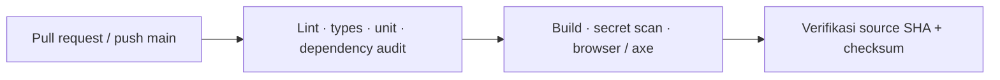

# AUU AHH Cafe — DevOps, DevSecOps & SRE Portfolio

Portofolio sederhana untuk menunjukkan praktik DevOps dan DevSecOps pada aplikasi menu kafe: CI GitHub Actions, quality/security gates, integritas build, dan runbook operasi. Aplikasi dibuat dengan Next.js 16, React 19, dan TypeScript. Hosting Vercel yang pernah dipakai sudah didecommission; tidak ada situs produksi aktif.

[](https://github.com/Adrian463588/auu-ahh-cafe-menu/actions/workflows/ci.yml)

[Repo privat](https://github.com/Adrian463588/auu-ahh-cafe-menu)

Repo saat ini privat; akses source, badge, dan log Actions mengikuti izin GitHub. Hosting hanya memakai berkas statis, tanpa database atau runtime function.

## Yang diperagakan

| Area | Implementasi yang dapat diperiksa |
| --- | --- |
| DevOps | Pull request/push memicu CI; `npm ci` memakai lockfile; build dan hasil verifikasi terikat pada source commit |
| DevSecOps | ESLint/Next/TypeScript, Gitleaks pada history + source + export, audit dependency, Actions dengan SHA pinning/read-only token, dan checksum tool |
| Operasi | Runbook mencatat batas health probe dan decommission layanan; tidak ada endpoint produksi, probe berjadwal, atau klaim SLO aktif |



CI hanya memverifikasi source dan build; tidak ada langkah publikasi, secret hosting, atau health probe terjadwal. Untuk hosting baru diperlukan permintaan eksplisit dan credential baru.

`main` mewajibkan PR dan status **Quality and security gates** yang mutakhir, termasuk untuk admin; force-push dan penghapusan branch diblokir. Proyek memakai satu maintainer, sehingga tidak mengklaim adanya persetujuan reviewer kedua.

## Fitur

- 32 menu dalam 7 kategori dari dokumen asli, beserta harga dan varian Hot/Ice yang tercantum.
- Pencarian, filter kategori, jumlah pesanan, hapus, dan total rupiah.
- Keranjang dan detail pemesan disimpan hanya di perangkat pengunjung.
- Ringkasan untuk ditunjukkan ke kasir, dengan pilihan makan di tempat/bawa pulang, salin, dan cetak/simpan PDF melalui browser.
- Dukungan keyboard, layout ponsel/tablet/desktop, pemulihan error penyimpanan, dan penggunaan halaman yang sudah terbuka saat offline.

Ringkasan **belum dikirim atau dikonfirmasi oleh kafe**. Pembayaran, ketersediaan, serta permintaan khusus dikonfirmasi langsung ke kasir. Tidak ada pengumpulan pesanan di server.

## Menjalankan

Gunakan Node.js 24 dan npm.

```sh
npm ci --ignore-scripts
npm run dev
```

Buka URL lokal yang dicetak Next.js. Untuk build dan preview hasil produksi:

```sh
npm run build
npm run preview
```

Preview statis tersedia di `http://127.0.0.1:4173`.

## Verifikasi

```sh
npm run tools:install
npm run lint
npm run lint:workflows
npm test
npm run typecheck
npm audit --audit-level=low
npm run build
npm run release
npm run security:secrets
npx playwright install chromium
npm run test:e2e
```

Gitleaks dan actionlint diunduh dari repo penerbit dengan versi dan SHA-256 yang dikunci di `scripts/tools.mjs`. Tooling tersedia untuk Windows x64 dan Linux x64. Scanner memeriksa seluruh history Git yang reachable, file tracked saat ini, serta export publik; `.env` lokal bukan bagian dari Git atau export.

ESLint 10 memakai plugin Next.js, TypeScript, dan React Hooks langsung. Dependency `minimatch` pada rentang rentan 7–10 dioverride ke 11.0.1 untuk [GHSA-g3hv-75wg-m249](https://github.com/advisories/GHSA-g3hv-75wg-m249); linter dan tes tetap menjadi gates kompatibilitas. Tidak memakai `npm audit fix --force` atau mengabaikan severity moderate.

Pengujian browser memakai katalog nyata untuk alur pesanan, ringkasan, pencarian, dan varian. Kasus tambahan menguji storage rusak/diblokir, clipboard gagal, offline, keyboard, cetak, serta axe pada lebar 320/375/768/1024/1440px. Artefak lokal disimpan pada `test-results/` yang diabaikan Git. Hasil eksekusi dicatat di `VALIDATION.md`; jangan menganggap daftar perintah sebagai bukti kelulusan.

## Status hosting

Proyek Vercel dan deployment yang sebelumnya aktif dihapus pada **10 November 2026** sesuai permintaan. Domain produksi, deployment, environment variables, dan pengaturan yang terikat pada proyek ikut terhapus. Repo GitHub privat dan source aplikasi tetap tersedia; tidak ada URL publik aktif.

Credential deployment lokal dan GitHub Actions telah dicabut/dihapus. Workflow tidak melakukan deployment. `scripts/deploy.mjs` dan `scripts/smoke.mjs` dipertahankan sebagai kode contoh yang tidak dipanggil CI; menjalankannya memerlukan konfigurasi hosting baru dan credential baru. Jangan menghidupkan deployment atau membuat proyek hosting baru tanpa permintaan eksplisit.

Hosting sebelumnya menggunakan [Vercel Hobby](https://vercel.com/docs/plans/hobby), yang ditujukan untuk penggunaan personal/nonkomersial. Aturan paket itu hanya konteks untuk deployment historis, bukan konfigurasi aktif.

GitHub memakai runner Linux standar, timeout per job, dan retensi artefak 3–7 hari. Pemakaian Actions pada repo privat tetap mengikuti kuota akun; tidak ada upgrade paket atau runner berbayar yang dikonfigurasi.

## Operasi dan bukti

Probe harian dan smoke produksi dihentikan bersama hosting pada **10 November 2026**. Target SLO yang pernah ditulis tidak berlaku pada kondisi sekarang; tidak ada pengukuran ketersediaan layanan aktif. Riwayat probe terdahulu adalah bukti historis dan tidak menunjukkan uptime saat ini.

- [Workflow CI dan bukti eksekusi](https://github.com/Adrian463588/auu-ahh-cafe-menu/actions/workflows/ci.yml)
- [Pemetaan kontrol dan rujukan primer](docs/DEVSECOPS.md)
- [Runbook operasi dan pemulihan](docs/OPERATIONS.md)
- [Kebijakan keamanan](SECURITY.md) dan [hasil verifikasi](VALIDATION.md)

Rujukan utama: [GitHub Actions security](https://docs.github.com/en/actions/reference/security/secure-use), [OWASP CI/CD risks](https://owasp.org/projects/top-10-cicd-security-risks), [NIST SSDF](https://csrc.nist.gov/pubs/sp/800/218/final), dan [Google SRE SLOs](https://sre.google/workbook/implementing-slos/). Implementasi ini menunjukkan kontrol dasar yang dapat diuji; tidak menyatakan sertifikasi standar atau jaminan tanpa kerentanan.

## Sumber menu dan struktur

`public/menu-asli.pdf` adalah salinan dokumen pengguna, halaman 1, tidak diubah. SHA-256: `f6a0694347193982d6e6a2bdcd2ca0f917c5a7f5de5baccc73c614a64ae51e5f`.

Nama yang tidak lazim tetap mengikuti sumber, termasuk Chocolatte, Redvelvet, dan Butterschotch. Harga K dikonversi ke rupiah; harga Corn Ribs Rp25.000 diverifikasi secara visual. Menu tidak menambahkan klaim stok, biaya tambahan, alamat, kontak, atau foto produk.

- `AGENTS.md` / `PRD.md`: aturan kerja dan kriteria penerimaan.
- `DESIGN_DIRECTION.md` / `DESIGN_SYSTEM.md`: keputusan visual.
- `lib/menu.ts`: katalog sumber; `lib/order.ts`: validasi dan perhitungan.
- `app/`: antarmuka; `tests/`: unit dan browser.
- `scripts/deploy.mjs` / `scripts/smoke.mjs`: contoh tooling hosting historis; tidak dipanggil oleh CI dan tidak memiliki credential aktif.

Nama dan catatan dapat dihapus dengan tombol **Pesanan baru** pada ringkasan. Data perangkat juga dapat dihapus melalui pengaturan situs browser.
